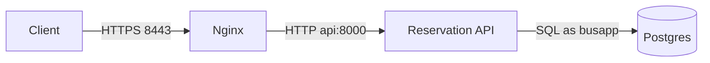

# Architecture

Assigned service: trip and seat reservation API for a bus booking platform.
The runnable deployment is Docker Compose on the local machine. A paid cloud account is not required by the brief, and none is used.

## Request path

| Piece | Role |
| --- | --- |
| Nginx | Public entry. Redirects port 8080 to HTTPS and terminates TLS. |
| API | FastAPI process running as uid 10001. Validates the booking and writes the PNR. |
| Postgres | Stores routes, trips, seats and bookings. Data lives in the `pgdata` volume. |
| GitHub Actions | Runs lint, tests, an image build tagged with the git commit, and a Trivy scan. |

Direct API and database ports are bound to `127.0.0.1` only. From another machine, the intended entry is the proxy.

## Booking transaction

`app/services/reservations.py` does the work inside one database transaction:

1. Load the trip and reject a past travel date, a date that does not match the trip, a stop on another route, or a drop stop that is not after the boarding stop.
2. `SELECT ... FROM seats ... FOR UPDATE` so concurrent requests for that seat queue on the row.
3. Insert the confirmed booking and mark the seat booked.
4. Commit. The loser of the race gets `409 seat_conflict` and no PNR.

Cancelled rows stay in `bookings` for history. The unique index `bookings_one_confirmed_seat` applies only while `status = 'confirmed'`, so a cancelled seat can be booked again and a duplicate confirmed row cannot be inserted even if the application check is skipped.

## Configuration and privileges

- The API reads `DATABASE_URL`, `API_KEY`, `LOG_LEVEL` and `TZ_NAME` from the environment.
- `.env` is local and gitignored. `.env.example` has placeholders.
- The application connects as `busapp`, which can select, insert and update. It cannot drop tables. Backups use the Postgres superuser inside the database container.
- Booking and cancellation require header `X-API-Key`. Health, readiness, catalog reads and ticket lookup by PNR do not.
- Logs are JSON on stdout. They include the PNR, trip and seat. They do not include the API key.

## What this deployment does not include

- A real public certificate. The proxy generates a local self-signed certificate on first start.
- More than one API replica, a hosted container registry, or a cloud load balancer.
- Payment, login accounts, or the rest of a passenger product. Those are outside the allocated service.
